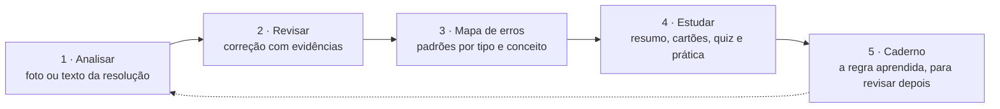
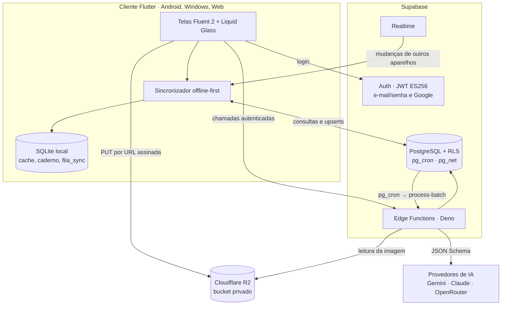
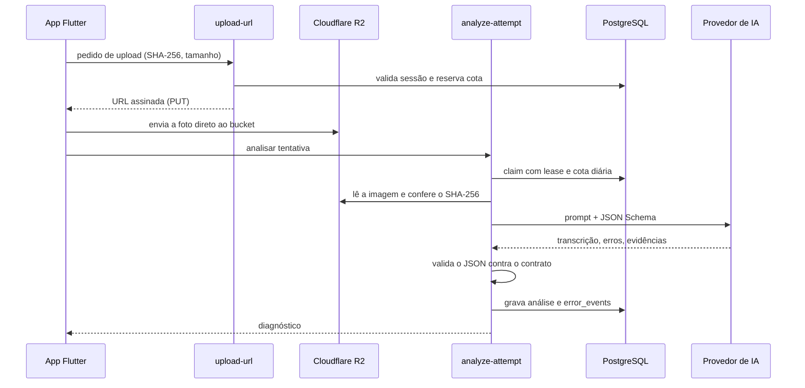
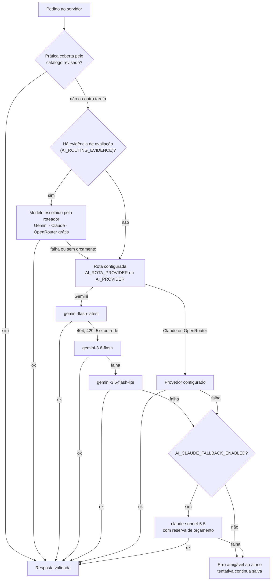
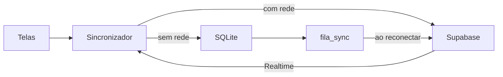

<a id="readme-top"></a>

<div align="center">

# MistakeMap

### Transforme cada erro em um mapa do que estudar a seguir.

O **MistakeMap** lê a sua resolução, aponta **onde** e **por que** você errou, conecta esses erros aos conceitos certos e monta um plano de estudo a partir deles. Funciona no celular, no computador e no navegador, inclusive sem internet.

[](https://mistakemap-tau.vercel.app/)

[](https://github.com/CFSJCODE/MistakeMap/actions/workflows/ci.yml)
[](https://github.com/CFSJCODE/MistakeMap/actions/workflows/supabase-deploy.yml)
[](https://github.com/CFSJCODE/MistakeMap/actions/workflows/supabase-functions-deploy.yml)
[](https://github.com/CFSJCODE/MistakeMap/actions/workflows/web-deploy-vercel.yml)
[](https://github.com/CFSJCODE/MistakeMap/actions/workflows/sync-repository-metadata.yml)
[](https://mistakemap-tau.vercel.app/)


[](LICENSE)


[Por que o MistakeMap](#por-que) · [Como funciona](#como-funciona) · [Funcionalidades](#funcionalidades) · [Arquitetura](#arquitetura) · [Começar](#comecar) · [Roadmap](#roadmap)

</div>

---

<a id="por-que"></a>

## Por que o MistakeMap

> **A nota diz que você errou. O MistakeMap diz o que fazer com isso.**

Quem estuda resolvendo exercícios conhece o ciclo: a prova volta corrigida, o aluno olha a nota, guarda a folha e repete o mesmo deslize semanas depois. O problema não é falta de esforço. É que **ninguém organiza os erros**: eles ficam espalhados em cadernos, provas e listas, e o padrão por trás deles nunca aparece.

O MistakeMap trata cada erro como um **dado de aprendizagem**:

| Sem o MistakeMap | Com o MistakeMap |
|:---|:---|
| "Errei a questão 4." | "Pela terceira vez em duas semanas, troquei o sinal ao isolar a variável em Cálculo." |
| Revisar tudo, ou revisar o que parece mais difícil | Revisar primeiro o que **mais se repete, mais recentemente e com menos sinal de recuperação** |
| Exercícios genéricos do livro | Exercícios **gerados para o seu tipo de erro**, com gabarito conferido no servidor |
| Anotações soltas que se perdem | Um **caderno de erros** que funciona offline e acompanha você em qualquer aparelho |

### Para quem

- **Estudantes** do ensino fundamental (7º ao 9º ano), do ensino médio, do ensino superior e **autodidatas**: o catálogo de matérias do banco já cobre essas quatro etapas.
- **Cursos de exatas e engenharias**, onde o erro de procedimento (sinal, unidade, condição de contorno) custa caro e se repete.
- **Professores, tutores e instituições** (próxima fase): visão agregada dos padrões de erro de uma turma, sempre com compartilhamento explícito e revogável pelo aluno.

### O que torna o produto diferente

| Diferencial | O que significa na prática |
|:---|:---|
| 🧭 **Erro com evidência** | Cada erro apontado pela IA vem com o trecho da resolução que o justifica e um nível de confiança. Nada de "está errado" sem explicação. |
| 🧑‍🏫 **O aluno decide** | A IA sugere hipóteses ("padrão sugerido"), o estudante confirma. O mapa nunca vira rótulo permanente. |
| 📶 **Offline de verdade** | Exercícios, tentativas e o caderno funcionam sem rede e sincronizam sozinhos quando a conexão volta. |
| 🔁 **Recuperação conta** | Acertar de novo um conceito reduz o peso dele no plano de estudo. O mapa mostra melhora, não só fragilidade. |
| 🔒 **Privado por padrão** | Os dados educacionais pertencem ao estudante. Isolamento por conta no próprio banco (RLS) e gabaritos que o cliente nunca enxerga. |
| 🤖 **Várias IAs, uma só interface** | Gemini por padrão, Claude Sonnet 5.5 e OpenRouter como alternativas, com cadeia de reserva automática: se um modelo cai, o próximo assume. |
| 💸 **Custo de operação próximo de zero** | A infraestrutura roda em camadas gratuitas (Supabase, Cloudflare R2, Gemini, Vercel); o único modelo pago (Claude) só entra com reserva de custo e teto mensal controlados no banco. |

---

<a id="como-funciona"></a>

## Como funciona

O app guia o estudante por um ciclo de cinco passos, sempre visível na tela inicial em **"O que fazer agora"**:



1. **Analisar.** O estudante fotografa a resolução (ou digita) e envia. A imagem vai direto para um bucket privado por URL assinada; a IA transcreve, compara com o esperado e classifica cada erro.
2. **Revisar.** A correção mostra cada erro com a categoria, o conceito envolvido, o trecho que serve de evidência e a confiança da IA. O exercício pode ser editado a qualquer momento.
3. **Mapa de erros.** Os erros se acumulam em um grafo de conceitos e em gráficos de frequência por tipo, mostrando o que se repete e em quais matérias.
4. **Estudar.** Para a matéria escolhida, a IA prepara um material no estilo NotebookLM: resumo, cartões de memorização e um quiz corrigido no servidor. Do quiz o aluno vai direto para a **prática direcionada**, escolhendo o tipo de erro que quer reforçar.
5. **Caderno.** O estudante registra, com as próprias palavras, a regra que aprendeu. O caderno vive no aparelho, funciona sem internet e sincroniza entre dispositivos.

### Taxonomia de erros

A IA classifica cada ocorrência em uma de **7 categorias**, a mesma usada para escolher a prática:

| `calculo` | `conceito` | `sinal` | `interpretacao` | `procedimento` | `unidade` | `outro` |
|:---:|:---:|:---:|:---:|:---:|:---:|:---:|
| conta errada | ideia mal aplicada | troca de sinal | enunciado mal lido | passo omitido ou fora de ordem | unidade ou dimensão | demais casos |

---

<a id="funcionalidades"></a>

## Funcionalidades

### Disponível hoje

| Área | O que o estudante tem | Onde está no código |
|:---|:---|:---|
| **Conta** | Cadastro e login com e-mail/senha ou **Google**, sessão persistente | `lib/auth/`, `lib/main.dart` |
| **Exercícios** | Criar, listar, editar, excluir e ver detalhes; lista e detalhe lado a lado em telas largas | `lib/main.dart` |
| **Análise por IA** | Transcrição da foto, erros por categoria e conceito, evidência e confiança; fila em lote processada pelo servidor | `analyze-attempt`, `process-batch` |
| **Mapa de erros** | Grafo de conceitos, frequência por tipo de erro, evidências por conceito | `lib/ai/insights_view.dart` |
| **Material de estudo** | Resumo, cartões e quiz gerados pela IA, com gabarito guardado e corrigido no servidor | `study-material`, `lib/ai/study_material_view.dart` |
| **Prática direcionada** | 3 a 5 exercícios por pedido, filtrados por tipo de erro; conceitos ranqueados por **frequência × recência** (meia-vida de 14 dias), descontando a recuperação já demonstrada | `generate-practice` |
| **Catálogo revisado** | 30 exercícios escritos e revisados por pessoas (5 por matéria/assunto/tema), servidos antes da IA quando cobrem a rodada | `catalog_exercises`, `_shared/catalog.ts` |
| **Caderno de erros** | Registro livre de erros e regras, com filtros que ficam salvos | `lib/caderno_erros.dart`, `lib/local/` |
| **Offline-first** | Tudo continua funcionando sem rede; o que foi feito offline sobe sozinho ao reconectar | `lib/sync/` |
| **Vários aparelhos** | Caderno, exercícios e exclusões chegam em tempo real aos outros dispositivos | Supabase Realtime, `lib/sync/caderno_sync.dart` |
| **Painel administrativo** | Papéis de usuário, métricas de uso, cotas e consumo da IA por modelo | `lib/admin/` |
| **Interface adaptativa** | Celular, tablet, desktop, dobráveis e telas duplas, com navegação própria para cada largura | `lib/layout/` |

### Plataformas

| Plataforma | Situação |
|:---|:---|
| 🌐 **Web** | Publicada em [mistakemap-tau.vercel.app](https://mistakemap-tau.vercel.app/) a cada atualização do `main` |
| 🤖 **Android** | Build de release funcional (APK); assinatura de loja pendente para a Play Store |
| 🪟 **Windows** | Build desktop funcional |
| 🍎 **iOS** | Adiado até haver Mac ou conta Apple Developer |

---

<a id="arquitetura"></a>

## Arquitetura

### Visão geral



**Princípio central:** o Flutter só apresenta e coleta. **OCR, LLM, correção de quiz, ranking e cotas ficam no servidor**, onde podem ser auditados, testados e protegidos. A chave `service_role` nunca entra no app.

### Stack

| Camada | Tecnologia | Papel |
|:---|:---|:---|
| Interface | Flutter 3.47 + Dart 3.13, `fluent_ui`, `liquid_glass_widgets` | Um único código para Android, Windows e Web |
| Estado | `StatefulWidget` + `setState` | Estado local por tela, sem framework extra |
| Banco local | SQLite (`sqflite`, `sqflite_common_ffi`, `sqflite_common_ffi_web`) + `shared_preferences` | Cache offline, caderno e fila de envio |
| Autenticação | Supabase Auth | E-mail/senha e Google OAuth; JWT ES256 |
| Banco | PostgreSQL (Supabase) | 31 migrations versionadas, RLS em todas as tabelas |
| Tempo real | Supabase Realtime | Propaga mudanças entre aparelhos |
| Backend | Supabase Edge Functions (Deno 2, TypeScript) | IA, upload, prática, estudo, lote e saúde |
| Jobs | `pg_cron` + `pg_net` | Processamento em lote sem HTTP síncrono em trigger |
| Arquivos | Cloudflare R2 | Fotos dos exercícios, compatível com S3, sem custo de saída |
| IA | Google Gemini (padrão), Anthropic Claude Sonnet 5.5, OpenRouter | OCR, classificação de erros, material e exercícios, com cadeia de reserva entre modelos ([detalhes](#provedores-ia)) |
| Web | Vercel | Hospedagem da versão web |
| CI/CD | GitHub Actions | Testes, migrations, funções e deploy web |

### Edge Functions

| Função | Método | O que faz |
|:---|:---:|:---|
| `upload-url` | `POST` | Valida a sessão, registra o SHA-256 calculado no app, reserva cota e assina um `PUT` na R2 |
| `analyze-attempt` | `POST` | Lê a imagem, confere o SHA-256, chama a IA com saída em JSON Schema, valida e grava a análise em uma única operação (ou devolve o resultado em cache) |
| `generate-practice` | `POST` | Escolhe os conceitos prioritários e serve o catálogo revisado ou gera exercícios novos, guardando o gabarito fora do alcance do cliente |
| `study-material` | `POST` | Gera resumo, cartões e quiz da matéria e corrige as respostas do quiz no servidor |
| `process-batch` | `POST` | Chamado pelo `pg_cron` com segredo próprio; analisa a fila de tentativas pendentes com *lease* e idempotência |
| `health` | `GET` | Verifica banco e R2 para o monitor de saúde |

Código compartilhado em `supabase/functions/_shared/`: contrato e validação da IA, HTTP/CORS/autenticação, cliente do provedor, catálogo, orçamento de IA (`claude_budget.ts`) e roteador de modelos (`model_router.ts`).

### Pipeline de IA



Salvaguardas do pipeline:

- **Saída estruturada e validada.** A resposta do modelo precisa passar pelo contrato em `ai_contract.ts`; o que não valida não é gravado.
- **Idempotência e concorrência.** `processing_runs` com *lease* evita análise duplicada; uma tentativa já analisada devolve o diagnóstico em cache.
- **Cotas e orçamento.** Limite diário por usuário (`ai_daily_usage`), reserva de custo antes de chamar provedores pagos (`ai_budget_reservations`) e falha fechada quando a tabela de preços precisa de revisão.
- **Troca de modelo só com evidência.** O roteador só escolhe outro modelo se houver avaliação com pelo menos 20 amostras na mesma tarefa, qualidade ≥ 0,8 e dados com menos de 30 dias; dentro de 2 pontos de qualidade, vence o mais barato.
- **Fallback em cadeia.** Se um modelo falha, o pedido passa ao próximo da cadeia (veja abaixo) sem expor o erro ao aluno.
- **Recusas tratadas.** Bloqueios de segurança do provedor viram uma mensagem clara ao aluno (HTTP 422); resposta truncada ou fora do contrato nunca é gravada.

<a id="provedores-ia"></a>

### Provedores e modelos de IA

Todas as chamadas passam por um único ponto, `structuredResponse()` em [`_shared/gemini.ts`](../supabase/functions/_shared/gemini.ts), usado pela análise, pelo material de estudo e pela prática. A escolha do modelo acontece só no servidor, que grava o modelo usado em `attempt_analyses.model` e `practice_sets.model`.

| Provedor | Modelo | Papel | Saída estruturada | Ativação |
|:---|:---|:---|:---|:---|
| **Google Gemini** | `gemini-flash-latest` | **Principal** (padrão) | `responseFormat` com JSON Schema, *thinking* `LOW` | `GEMINI_API_KEY`, `GEMINI_MODEL` |
| **Google Gemini** | `gemini-3.6-flash` | 1ª reserva | idem | `GEMINI_FALLBACK_MODEL` |
| **Google Gemini** | `gemini-3.5-flash-lite` | 2ª reserva, roda em capacidade separada e costuma responder quando os Flash estão sobrecarregados | idem | `GEMINI_LITE_MODEL` (`off` desliga) |
| **Anthropic** | `claude-sonnet-5-5` | Alternativa paga e **última reserva** quando todo o Gemini falha | `output_config` com JSON Schema, imagens em base64 | Rota direta: `AI_PROVIDER=anthropic` + `ANTHROPIC_API_KEY` + `ANTHROPIC_MODEL=claude-sonnet-5-5` (obrigatório; o controle de custo só aceita esse modelo). Última reserva: `AI_CLAUDE_FALLBACK_ENABLED=true` + `ANTHROPIC_API_KEY` (o modelo é definido internamente) |
| **OpenRouter** | configurável (`openrouter/free` ou modelos `:free` no roteador automático) | Alternativa, inclusive modelos gratuitos de terceiros | `response_format` `json_schema` estrito, `require_parameters` | `AI_PROVIDER=openrouter` + `OPENROUTER_API_KEY` + `OPENROUTER_MODEL` (obrigatório) |
| **OpenAI** | `gpt-4.1-mini` (Responses API) | Integração preparada e validada localmente, **ainda não ativada** | Structured Outputs | pendente de chave e publicação ([`_reversa_forward/openai-integration`](../_reversa_forward/openai-integration/README.md)) |

**Rotas por tarefa.** Cada tipo de chamada tem uma rota própria que pode apontar para outro provedor: `ANALYSIS` (texto), `VISION` (com imagem), `STUDY` (material de estudo) e `PRACTICE` (exercícios), configuradas por `AI_<ROTA>_PROVIDER` e `AI_<ROTA>_MODEL`. Sem configuração, todas usam `AI_PROVIDER` (padrão `gemini`).

**Ordem de decisão e fallback:**



1. **Catálogo primeiro.** Na prática, se o catálogo revisado cobre a rodada, nenhuma IA é chamada.
2. **Roteador automático.** Com evidência de avaliação, o roteador escolhe entre o Gemini principal, o Claude Sonnet 5.5 e modelos gratuitos do OpenRouter, desde que a chave do provedor esteja configurada e o custo seja de no máximo US$ 1 por pedido. Se o escolhido falhar, a chamada volta para a rota configurada.
3. **Cadeia do Gemini.** Até três tentativas, cada uma em um modelo diferente (principal → `gemini-3.6-flash` → `gemini-3.5-flash-lite`), com espera exponencial (0,5 s, 1 s) e um prazo total de 110 s para caber no limite de 150 s das Edge Functions.
4. **Última reserva: Claude.** Com `AI_CLAUDE_FALLBACK_ENABLED=true`, falhas de indisponibilidade, limite de taxa ou saída inválida/incompleta são repetidas no `claude-sonnet-5-5`.
5. **Sem resposta válida,** o aluno recebe uma mensagem amigável e a tentativa continua salva para uma nova análise.

**Controle de custo do Claude** (`_shared/claude_budget.ts` + migration `ai_budget_reservations`):

- conta os tokens de entrada antes de chamar (`count_tokens`) e recusa pedidos acima de 100 mil tokens de entrada ou 16 mil de saída;
- reserva US$ 1 por pedido e acerta o valor real depois da resposta;
- teto de **US$ 100 em qualquer janela móvel de 31 dias**, verificado no banco com trava (`reserve_claude_budget`);
- **falha fechada**: se a contagem não puder ser feita ou se a tabela de preços passar da validade (01/12/2026), a chamada paga não acontece.

**Observabilidade.** Retentativas e erros dos provedores aparecem nos logs (`ai_provider_retry`, `ai_provider_error`) só com código e status, nunca com conteúdo do aluno. O painel administrativo mostra as cotas do plano gratuito do Gemini por modelo (RPM, TPM e RPD); a telemetria detalhada por provedor está preparada em [`_reversa_forward/admin-monitoring`](../_reversa_forward/admin-monitoring/README.md).

> [!NOTE]
> Na camada gratuita do Gemini, o Google pode usar prompts e imagens para melhorar seus produtos. Fotos com nome ou matrícula devem ser recortadas antes do envio, ou deve-se usar uma camada paga.

### Priorização da revisão

A prioridade de um conceito segue o modelo:

$$
P = F \times R \times I \times (1 - M)
$$

| Termo | Significado | Situação |
|:---:|:---|:---:|
| $F$ | Frequência normalizada do erro | ✅ |
| $R$ | Recência, com meia-vida de 14 dias sobre `attempted_at` | ✅ |
| $I$ | Importância do conceito | 🔜 |
| $M$ | Evidência de recuperação entre 0 e 1 (`mastery_events`; três acertos tiram o foco do conceito) | ✅ |

Hoje $F$, $R$ e $M$ já ordenam a prática direcionada. O objetivo é **ordenar a revisão**, nunca dar uma nota à capacidade do estudante.

### Offline-first e sincronização



- **Leitura:** o app consulta o Supabase primeiro e cai no SQLite quando não há rede.
- **Escrita offline:** vai para a `fila_sync` com UUIDs gerados no aparelho; o envio é um *upsert* idempotente, então repetir não duplica.
- **Tempo real:** `subjects`, `attempts`, `attempt_analyses`, `error_notes` e `deleted_records` chegam aos outros aparelhos pelo Realtime.
- **Caderno:** espelhado em `error_notes`; vence a última escrita por `updated_at`, e a exclusão vence sempre (tombstone `deleted_at`).
- **Exclusões:** registradas em `deleted_records`. O trigger `block_deleted_reinsert` responde com SQLSTATE `MM410` se uma fila antiga tentar recriar algo apagado, e o outro aparelho mostra "excluído em outro aparelho".

Detalhes do esquema local e das versões do banco em [`BANCO_LOCAL.md`](../appmistakemap/BANCO_LOCAL.md).

### Modelo de dados

| Grupo | Tabelas principais |
|:---|:---|
| Estudo | `subjects`, `exercises`, `attempts`, `attempt_assets`, `corrections` |
| Conhecimento | `concepts`, `concept_edges`, `exercise_concepts`, `error_types`, `learning_subjects` |
| Diagnóstico | `attempt_analyses`, `error_events`, `ocr_artifacts`, `processing_runs`, `mastery_events` |
| Prática e estudo | `practice_sets`, `practice_answer_keys`, `catalog_exercises`, `catalog_answer_keys`, `study_materials`, `study_quiz_rounds`, `study_quiz_keys` |
| Caderno e sync | `error_notes`, `notebook_entries`, `deleted_records` |
| Operação | `profiles`, `ai_daily_usage`, `ai_budget_reservations`, `ai_api_events`, `rate_limits`, `audit_log`, `r2_quota_usage` |

As migrations ficam em [`appmistakemap/database/supabase/migrations/`](../appmistakemap/database/supabase/migrations/) e são **imutáveis**: toda correção vira uma migration nova, aplicada automaticamente no merge do `main`.

### Segurança e privacidade

| Mecanismo | Como é aplicado |
|:---|:---|
| **Row Level Security** | Todas as tabelas com RLS; cada aluno só enxerga as próprias linhas. Diagnósticos são somente leitura para o dono e escritos pelo servidor |
| **Gabaritos protegidos** | `practice_answer_keys`, `catalog_answer_keys` e `study_quiz_keys` não têm acesso do cliente; a correção acontece no servidor |
| **Segredos** | `service_role` e chaves de IA/R2 só existem nas Edge Functions, configuradas como *secrets*; nada disso fica no Git |
| **Arquivos** | Bucket R2 privado, upload por URL assinada de curta duração, integridade por SHA-256 |
| **Jobs** | `process-batch` exige um segredo próprio; nada de HTTP síncrono dentro de trigger |
| **Auditoria** | `audit_log` *append-only* para mutações sensíveis |
| **Dados educacionais** | Sem ranking público e sem exposição automática de fragilidades. O mapa pertence ao estudante; compartilhar deve ser explícito, granular e revogável |

Decisões de backend e o histórico da migração do worker Rust para as Edge Functions estão em [`BACKEND.md`](../BACKEND.md).

---

<a id="design"></a>

## Design e experiência

- **Identidade Obsidian Glass em modo claro.** Fundo claro com brilhos suaves e acentos vivos com função: Aqua (Início e ações principais), Azure (Lista), Violeta (Mapa e IA), Âmbar (Caderno), Mint (acerto) e Coral (erro). Texto colorido usa variantes "Ink" com contraste **≥ 4,5:1**. Paleta em [`PALETA.md`](../appmistakemap/PALETA.md).
- **Fluent 2 + Liquid Glass.** Componentes Fluent para a estrutura e vidro líquido nas barras e avisos, sempre legível mesmo sem translucidez.
- **Toque uniforme.** Todos os botões respondem com a mesma animação (escala 0,97 em 120 ms).
- **Navegação por largura de tela** ([`NAVEGACAO.md`](../appmistakemap/NAVEGACAO.md)):

| Largura | Navegação |
|:---|:---|
| < 600 px (celular) | Barra de vidro de ponta a ponta com 7 fatias: **Início · Lista · Mapa · Estudar · Caderno · Sobre · Mais** |
| 600 – 840 px (tablet, dobrável) | Trilho compacto com ícone e rótulo, e botão Analisar no topo |
| ≥ 840 px (desktop, web) | Trilho largo com seções, Estudar logo abaixo do Mapa e Analisar em destaque |

O Mapa é uma aba com pilha própria (a barra não some ao navegar dentro dele) e o Voltar é previsível em todas as plataformas.

---

<a id="qualidade"></a>

## Qualidade e engenharia

| Prática | Como é garantida |
|:---|:---|
| **Testes do app** | 25 arquivos de teste Flutter (widgets, navegação, layout, banco local, sincronização com SQLite em memória, contratos) |
| **Testes do backend** | 6 suítes `deno test` (contrato da IA, catálogo, orçamento, roteador de modelos, estudo, upload) |
| **Análise estática** | `flutter analyze` sem avisos e `dart format` obrigatórios; `deno check` nas funções |
| **Migrations** | Imutáveis, versionadas e aplicadas pelo CI; o histórico do repositório é conferido com o do banco publicado |
| **Revisão** | PRs pequenos e focados, com revisão automática e checks obrigatórios no `main` |

| Workflow | Quando roda | O que faz |
|:---|:---|:---|
| [`ci.yml`](workflows/ci.yml) | Push e PR no `main` | `deno check`/`deno test`, `flutter analyze`, `dart format` e `flutter test` |
| [`supabase-deploy.yml`](workflows/supabase-deploy.yml) | Push no `main` que altera migrations | Aplica as migrations no Supabase |
| [`supabase-functions-deploy.yml`](workflows/supabase-functions-deploy.yml) | Push no `main` que altera `supabase/` | Publica as Edge Functions |
| [`web-deploy-vercel.yml`](workflows/web-deploy-vercel.yml) | Push no `main` que altera o app | Gera o build web e publica na Vercel |
| [`sync-repository-metadata.yml`](workflows/sync-repository-metadata.yml) | Mudanças em `LICENSE` ou `CITATION.cff` | Garante que as cópias da raiz batem com as de `.github/` |

---

<a id="comecar"></a>

## Começar

### Experimentar sem instalar

Abra **[mistakemap-tau.vercel.app](https://mistakemap-tau.vercel.app/)**, crie uma conta (ou entre com Google) e siga os passos de "O que fazer agora".

### Rodar localmente

Pré-requisitos: Flutter estável (validado com **3.47.2 / Dart 3.13**), o SDK da plataforma de destino (Android SDK, Visual Studio para Windows ou Chrome) e, só para as Edge Functions, **Deno 2**.

```bash
git clone https://github.com/CFSJCODE/MistakeMap.git
cd MistakeMap/appmistakemap
flutter pub get
flutter run -d chrome        # ou: -d android / -d windows
```

O app já aponta para o projeto Supabase publicado; **nenhuma chave privada é necessária** para rodar o cliente.

> [!TIP]
> No Windows, clone em um caminho **sem acentos** (por exemplo, `D:\MistakeMap`). Acentos no caminho quebram o `flutter analyze` e o build AOT.

### Validar como o CI

```bash
# em appmistakemap/
flutter analyze
dart format --set-exit-if-changed lib/
flutter test --reporter compact

# em supabase/functions/
deno check --frozen */index.ts
deno test --frozen --allow-env
```

> [!NOTE]
> Na Web, `web/sqlite3.wasm` precisa casar com a versão do pacote `sqlite3` registrada no `pubspec.lock`. Evite adicionar `path_provider`: ele puxa `jni` e quebra o build Windows sem JDK.

---

<a id="estrutura"></a>

## Estrutura do repositório

```text
MistakeMap/
├── appmistakemap/               # App Flutter (Android, Windows, Web)
│   ├── lib/
│   │   ├── main.dart            # Bootstrap, Auth e telas principais
│   │   ├── caderno_erros.dart   # Caderno de erros
│   │   ├── about/  admin/  auth/  assets/
│   │   ├── ai/                  # Envio, correção, mapa, material de estudo e prática
│   │   ├── layout/              # Larguras, dobráveis e shell de navegação
│   │   ├── local/               # SQLite (io e web), DAO do caderno, conta offline
│   │   ├── sync/                # Sincronizador, fila, Realtime, sync do caderno
│   │   └── theme/               # Tokens de design, paleta e movimento
│   ├── test/                    # Testes Flutter
│   ├── database/supabase/migrations/   # Migrations canônicas do Supabase
│   └── BANCO_LOCAL.md · NAVEGACAO.md · PALETA.md · GOOGLE_AUTH.md
├── supabase/
│   ├── functions/               # Edge Functions (Deno) + _shared + tests
│   └── config.toml
├── worker/                      # Worker Rust original (arquivado)
├── .github/                     # README, CI/CD, licença, citação e políticas
├── AGENTS.md · CLAUDE.md · GEMINI.md   # Regras e decisões para agentes de código
└── BACKEND.md                   # Decisões de arquitetura do backend
```

---

<a id="roadmap"></a>

## Roadmap

| Fase | Entregas | Situação |
|:---|:---|:---:|
| **0 · Fundação** | Flutter, Fluent UI, Supabase, Auth | ✅ |
| **1 · Matérias e exercícios** | Cadastro de matérias e exercícios; catálogo de matérias por etapa de ensino no banco | ✅ |
| **2 · Tentativas** | Fotos, correções e histórico | ✅ |
| **3 · Erros** | Taxonomia de 7 categorias e eventos de erro | ✅ |
| **4 · IA** | OCR, erros com evidência, material de estudo e prática | ✅ |
| **5 · Offline e multi-aparelho** | SQLite, fila de envio, Realtime, caderno sincronizado | ✅ |
| **6 · Prioridade** | Fila de revisão explicável com $P = F \times R \times I \times (1 - M)$ | 🟡 F, R e M prontos; falta I e a fila |
| **7 · Validação humana** | Confirmar, corrigir ou rejeitar cada erro sugerido | 🔜 |
| **8 · Relatórios** | PDF/CSV e compartilhamento seletivo com professor ou tutor | 🔜 |
| **9 · Lojas** | Play Store (assinatura de release) e iOS | 🔜 |

Próximos passos conhecidos: tela própria para navegar no catálogo e mais temas; mostrar nos insights o que ainda está na fila de envio; manter o foco da prática ao recarregar; mover o segredo do `pg_cron` para o Vault; remover da R2 as fotos de tentativas excluídas.

---

<a id="historico"></a>

## Histórico recente

| PR | Entrega |
|:---:|:---|
| [#17](https://github.com/CFSJCODE/MistakeMap/pull/17) | Análise da IA gravada como objeto JSON e fallback do Gemini ampliado |
| [#18](https://github.com/CFSJCODE/MistakeMap/pull/18) | Caderno de erros offline em SQLite, com CRUD e filtros persistidos |
| [#20](https://github.com/CFSJCODE/MistakeMap/pull/20) | Prática por tipo de erro e ranking por frequência × recência com desconto de recuperação |
| [#22](https://github.com/CFSJCODE/MistakeMap/pull/22) · [#23](https://github.com/CFSJCODE/MistakeMap/pull/23) | Navegação repensada e identidade Obsidian Glass em modo claro |
| [#24](https://github.com/CFSJCODE/MistakeMap/pull/24) | Offline-first: Supabase primeiro, SQLite sem rede, fila de envio e Realtime |
| [#27](https://github.com/CFSJCODE/MistakeMap/pull/27) | Material de estudo estilo NotebookLM na aba Estudar |
| [#29](https://github.com/CFSJCODE/MistakeMap/pull/29) · [#30](https://github.com/CFSJCODE/MistakeMap/pull/30) | Ciclo de estudo guiado no Início, app inteiro offline e barra em vidro líquido |
| [#31](https://github.com/CFSJCODE/MistakeMap/pull/31) | Mapa como aba com pilha própria, trilho em janelas médias e Voltar previsível |
| [#32](https://github.com/CFSJCODE/MistakeMap/pull/32) · [#34](https://github.com/CFSJCODE/MistakeMap/pull/34) · [#35](https://github.com/CFSJCODE/MistakeMap/pull/35) · [#37](https://github.com/CFSJCODE/MistakeMap/pull/37) | Barra inferior de 7 fatias e trilho compacto completo |
| [#36](https://github.com/CFSJCODE/MistakeMap/pull/36) | Estudo atualizado, múltiplos provedores de IA e orçamento por reserva |
| [#38](https://github.com/CFSJCODE/MistakeMap/pull/38) | Caderno entre aparelhos, exclusões em tempo real com barreira `MM410` e catálogo de 30 exercícios revisados |
| [#39](https://github.com/CFSJCODE/MistakeMap/pull/39) | Histórico de migrations alinhado ao banco publicado e prática que segue para a IA quando o catálogo não basta |

---

<a id="equipe"></a>

## Equipe e contexto acadêmico

O MistakeMap nasceu na disciplina **Projeto Integrado I: Desenvolvimento Móvel** do curso de **Engenharia de Computação da PUC Minas**.

| | |
|:---|:---|
| **Autores** | **Cláudio Francisco Dos Santos Júnior** · **Lucas Emanuel Simão Silva** |
| **Orientação** | **Ilo Amy Saldanha Rivero** |
| **Instituição** | Pontifícia Universidade Católica de Minas Gerais (PUC Minas) |
| **Versão** | 1.0.0 · novembro de 2026 |

---

<a id="licenca"></a>

## Licença, uso e citação

O código é distribuído sob a **[PolyForm Noncommercial License 1.0.0](LICENSE)**: uso pessoal, educacional e de pesquisa é permitido; **uso comercial** (SaaS, white-label, incorporação em produto pago) exige uma licença comercial separada, concedida pelos autores. Interessados em licenciar o MistakeMap para uma escola, curso ou plataforma podem abrir uma [issue](https://github.com/CFSJCODE/MistakeMap/issues) ou falar diretamente com os autores.

- [Política de uso e atribuição](USAGE_POLICY.md)
- [Marcas](TRADEMARKS.md) · [Governança](GOVERNANCE.md) · [Avisos](NOTICE)
- [Como contribuir](CONTRIBUTING.md)
- Para citar em trabalhos acadêmicos, use o [`CITATION.cff`](CITATION.cff) (botão **Cite this repository** do GitHub).

---

<div align="center">

**O erro não é o fim da resolução. É um sinal.**

[Experimentar o MistakeMap](https://mistakemap-tau.vercel.app/) · [Ver o código](https://github.com/CFSJCODE/MistakeMap) · [Decisões de backend](../BACKEND.md)

<sub>Flutter · Dart · Fluent 2 · Liquid Glass · Supabase · PostgreSQL · Realtime · SQLite · Edge Functions · Cloudflare R2 · Gemini · Claude · OpenRouter · Vercel</sub>

<p align="right"><a href="#readme-top">↑ Voltar ao topo</a></p>

</div>
