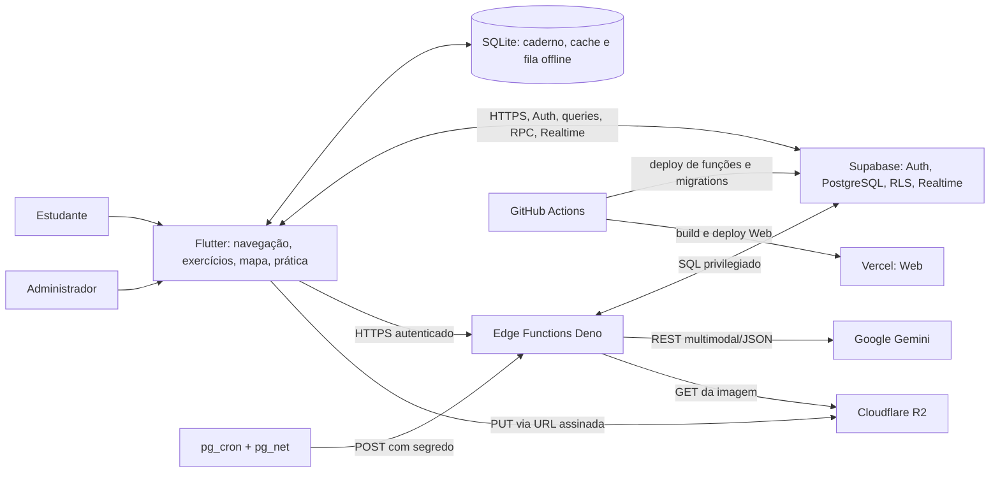
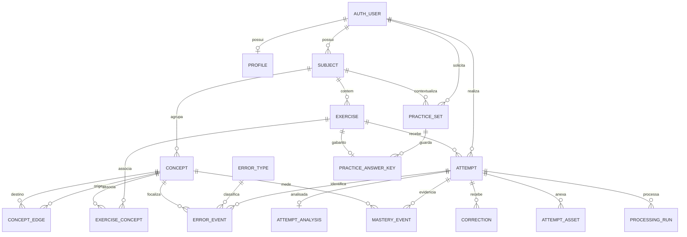

# Arquitetura do MistakeMap

> Nível: Essencial. Síntese do código e das migrations locais; o estado do
> banco remoto não foi consultado nesta análise.

## Visão geral

O MistakeMap combina um cliente Flutter multiplataforma, serviços Supabase e
integrações externas para registrar exercícios e tentativas, analisar respostas
com IA, visualizar padrões de erro e gerar prática direcionada.

O worker Rust é uma implementação histórica arquivada, não um container ativo
do sistema. Seu pipeline não executa OCR/LLM e não deve ser reativado como
substituto do backend atual.

## Componentes e responsabilidades

| Componente | Responsabilidade |
|---|---|
| Flutter | Autenticação, navegação, cadastro de exercício/tentativa, análise visual, mapa, prática, administração e experiência offline. |
| SQLite local | Caderno manual, cache de consultas e fila idempotente para sincronização posterior. |
| Supabase Auth | Sessão do estudante e identidade usada para escopo por usuário. |
| PostgreSQL + RLS | Matérias, conceitos, exercícios, tentativas, análises, eventos, práticas, cotas e políticas de propriedade. |
| Edge Functions | Upload assinado, análise Gemini, geração de prática, processamento em lote e healthcheck. |
| Gemini | OCR multimodal, diagnóstico pedagógico estruturado e geração de questões. |
| Cloudflare R2 | Armazenamento de fotos fora do cliente; upload usa URL pré-assinada. |
| `pg_cron` + `pg_net` | Disparo periódico do lote e monitoramento/alertas operacionais. |
| GitHub Actions + Vercel | CI por stack, publicação Supabase e deploy da versão Web. |

## Fluxos principais

### Registrar e analisar tentativa

1. O estudante cria uma matéria/exercício ou seleciona exercício existente.
2. O Flutter cria uma tentativa `pending` (texto) ou `uploading` (foto).
3. Para foto, o app pede URL assinada, envia os bytes ao R2 e registra o asset
   com hash; só então marca a tentativa pronta.
4. `analyze-attempt` valida a identidade, verifica propriedade e integridade
   da imagem, reivindica a análise com lock/lease e chama Gemini.
5. Uma transação grava análise, correção, conceitos, eventos de erro
   `pending` e eventos de domínio sugeridos.
6. Flutter carrega o resultado e atualiza o mapa. A análise é uma sugestão;
   não existe ainda ação persistente para confirmar ou corrigir cada erro.

### Gerar prática

1. O app envia matéria, quantidade (3–5) e categoria opcional.
2. A Edge Function lê erros anteriores e calcula prioridade por recência e
   recuperação, se houver.
3. Gemini gera novos itens; o servidor guarda as respostas em
   `practice_answer_keys`, sem devolvê-las na resposta de geração.
4. O estudante responde por tentativa individual e recebe análise.

O fluxo não apresenta uma sessão de quiz com resumo agregado. A geração não
recebe enunciados-fonte completos e, sem erros, baseia-se somente no nome da
matéria; portanto, o requisito de derivar todos os exercícios de exercícios
existentes não está garantido.

### Sincronização offline

Leituras tentam Supabase primeiro e atualizam o cache SQLite. Operações de
escrita offline entram numa fila local por usuário e sincronizam em ordem,
com UUIDs estáveis e tratamento explícito de conflito. O caderno manual não
alimenta diretamente o mapa de análise.

## Modelo de dados resumido

`exercise_concepts` representa a relação N:N entre exercícios e conceitos.
`concept_edges` guarda relações direcionadas, mas a visualização atual do mapa
deriva coocorrência nas tentativas. `practice_sets.source_attempt_ids` é um
array UUID sem FK, não representado como relação no ERD.

## Integrações e limites de confiança

- Flutter usa Supabase Auth/DB/Realtime, mas nunca recebe segredos de Gemini,
  R2 ou `service_role`.
- URLs de upload são temporárias e limitadas por tipo/tamanho; o servidor
  confere escopo do caminho, assinatura binária e SHA-256 antes de enviar a
  foto à IA.
- Handlers de IA validam a saída contra schemas e tratam conteúdo do estudante
  como dado não confiável. A resposta correta de prática fica no servidor.
- O cliente e o banco local são tratados como não confiáveis para status de
  análise; trigger e backend controlam estado/versão.
- RLS protege dados acadêmicos por usuário. O papel `admin` tem políticas
  específicas para perfis e métricas, não acesso geral implícito às tentativas.

## Dívidas arquiteturais prioritárias

1. Implementar validação auditável dos eventos de erro pelo estudante e fazer
   essa validação governar evolução/prioridade.
2. Fundamentar a geração nos exercícios existentes, incluindo exemplos-fonte
   relevantes em ambos os caminhos (com e sem erro pendente).
3. Persistir ou estruturar uma rodada de quiz para métricas, assuntos frágeis e
   repetição de rodada; adicionar revisão teórica/flashcards.
4. Aproximar a taxonomia das categorias do briefing (negação lógica e condição
   de contorno) com contrato, migration e interface coordenados.
5. Integrar caderno local ao mapa, se essa for a regra de produto.
6. Esclarecer que a prioridade implementada não inclui o fator `importance`
   presente na fórmula documentada do projeto.
7. Criar entrega/publicação Android e Windows, caso APK/desktop distribuível
   seja requisito da sprint; hoje há workflow de deploy Web.
8. Não reativar o worker Rust sem reconstruir análise e retries: o código
   arquivado marca como concluído após baixar os assets, antes de OCR/LLM.

## Confiança

- 🟢 **CONFIRMADO** — componentes e fluxos observados no código e nas migrations locais.
- 🟡 **INFERIDO** — boundaries e relações arquiteturais sintetizados a partir das dependências.
- 🔴 **LACUNA** — funcionalidade desejada que não existe ou não foi confirmada nesta análise.
