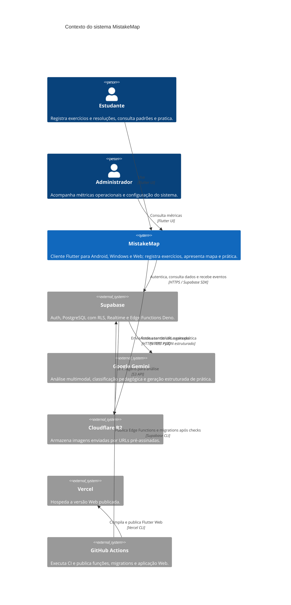

# C4 — Contexto do MistakeMap

## Observações

- O sistema de produto inclui o cliente Flutter; Supabase, Gemini, R2, Vercel e
  GitHub Actions são plataformas externas ou serviços integrados.
- O SQLite e a fila offline são internos ao cliente Flutter e não foram
  representados como sistema externo.
- O worker Rust não aparece como sistema ativo: está arquivado e não participa
  dos fluxos atuais.
- `/health` é público e não expõe dados acadêmicos. Operações de análise e
  prática exigem autenticação validada no backend; o job de lote usa segredo
  próprio de cron.
- O diagrama descreve o código e a configuração versionados; não confirma a
  topologia exata atualmente implantada em produção.
