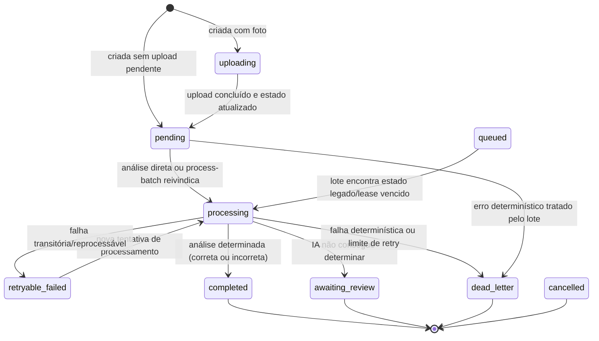
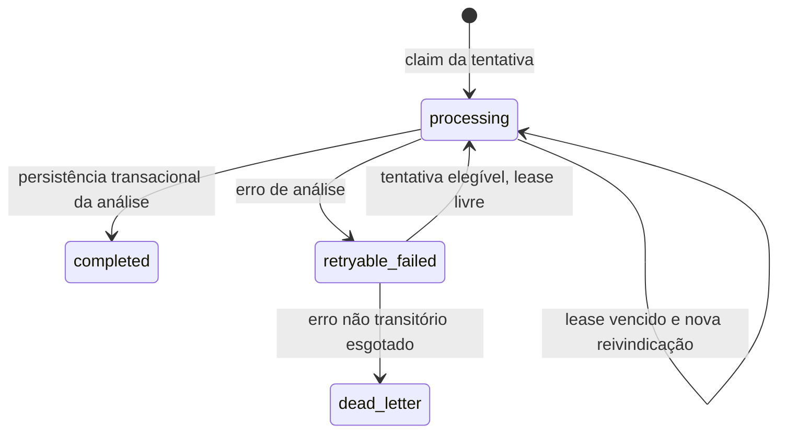
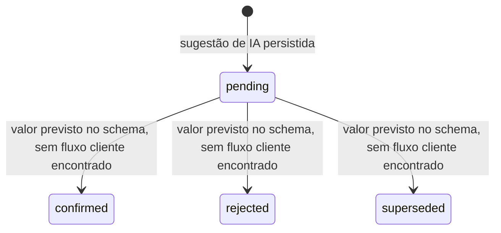

# Máquinas de estado

> Nível: Essencial. Estados e transições foram extraídos das migrations,
> Edge Functions e cliente. Transições sem implementação não são presumidas.

## Tentativa (`attempts.status`)

### Significado e origem

| Estado | Significado observado |
|---|---|
| `uploading` | Tentativa com imagem ainda não confirmada; cliente pode concluir upload. |
| `pending` | Dados prontos para análise. Tentativas sem imagem começam nesse estado. |
| `queued` | Estado legado aceito pelo processador em lote; não é produzido pelo fluxo atual de `analyzeAttempt`. |
| `processing` | Análise reivindicada; `processing_runs` mantém lease de 180 segundos e versão da pipeline. |
| `awaiting_review` | Análise inconclusiva (`is_correct=null`); a tela pede conferência, mas não há transição de revisão de erro implementada. |
| `completed` | Análise determinada. O estado não codifica acerto/erro. |
| `retryable_failed` | Falha reprocessável; lote pode tentar novamente, sujeito a cota e limite de retry. |
| `dead_letter` | Tentativa não deve ser repetida automaticamente; a interface apresenta análise interrompida. |
| `cancelled` | Estado permitido no schema, mas não foi localizado um fluxo cliente que o produza. |

### Regras de transição

- O trigger `guard_attempt_ai_state` só permite ao cliente criar em
  `uploading`/`pending` com `version=1` e, depois, mover a tentativa entre esses
  estados sem alterar proprietário, exercício ou versão arbitrariamente.
- A análise confere versão, bloqueia tentativa `uploading`/`cancelled`, usa
  lock para impedir chamadas concorrentes e reserva cota diária antes da
  geração do modelo.
- `is_correct=true` e `false` concluem a tentativa como `completed`;
  `is_correct=null` leva a `awaiting_review`. Separadamente, eventos de erro
  continuam `pending`.
- Falhas são registradas em `processing_runs`; erros determinísticos e limite
  de retry podem levar a `dead_letter`, enquanto falhas transitórias podem
  continuar reprocessáveis.
- O estado de tela agrupa `uploading`, `pending`, `queued`, `processing` e
  `retryable_failed` como pendentes; `awaiting_review` é revisão; `dead_letter`
  é falha; `completed` indica somente análise finalizada.

## Execução (`processing_runs.status`)

Uma execução é única por `attempt_id` e `pipeline_version`. O retry conta até
três chamadas por pipeline, com erros transitórios específicos podendo
continuar reprocessáveis. O endpoint de lote processa no máximo uma chamada de
modelo por invocação.

## Evento de erro (`error_events.status`)

O banco aceita `pending`, `confirmed`, `rejected` e `superseded`, mas a IA
somente insere `pending`. Políticas e grants atuais reservam escrita ao
backend; aceite, correção ou rejeição pelo estudante são uma lacuna, não uma
transição funcional existente.
