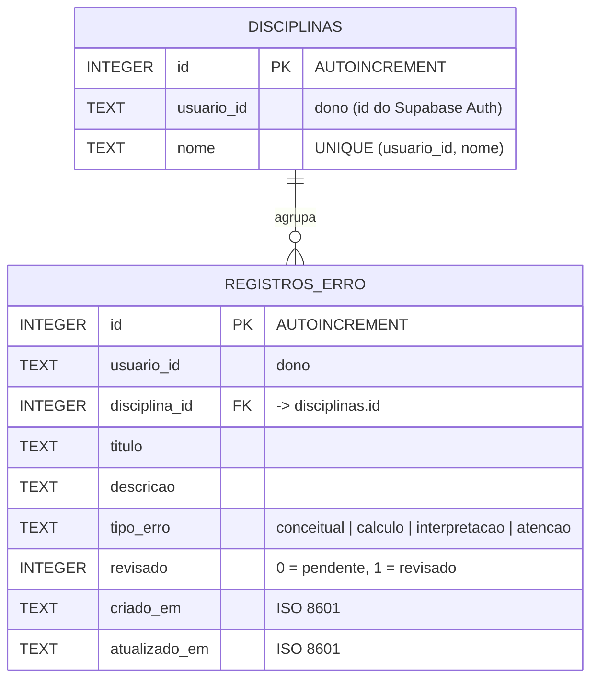

# Banco de dados local — Caderno de erros

Persistência no próprio aparelho, seguindo as aulas LDDM08 (Shared Preferences)
e LDDM09 (SQLite com `sqflite`). Funciona sem internet e é independente do
Supabase: apagar o app apaga estes dados.

| Mecanismo | Pacote | Para quê |
|---|---|---|
| SQLite | `sqflite` (Android/iOS/macOS), `sqflite_common_ffi` (Windows/Linux), `sqflite_common_ffi_web` (Web) | Registros de erro e disciplinas, com CRUD |
| Shared Preferences | `shared_preferences` | Preferência "Ocultar revisados" da lista |

Arquivo do banco: `mistakemap_local.db`, versão 1
(`lib/local/banco_local.dart`). Na Web ele fica no IndexedDB do navegador,
usando `web/sqlite3.wasm` e `web/sqflite_sw.js`.

## 1. Projeto do banco de dados

### Minimundo

O estudante anota os erros que cometeu para revisar depois. Cada erro pertence
a uma disciplina, tem um tipo (conceitual, cálculo, interpretação ou atenção) e
uma situação (pendente ou revisado). Uma disciplina agrupa vários erros.
Duas contas no mesmo aparelho não veem os dados uma da outra (`usuario_id`).

### Modelo entidade-relacionamento



Cardinalidade: uma disciplina tem zero ou mais registros (1:N); cada registro
tem exatamente uma disciplina.

### Modelo físico (SQL executado no `onCreate`)

O SQLite só tem os tipos `TEXT`, `INTEGER` e `REAL`, então booleano vira
`INTEGER` (0/1) e data vira `TEXT` em ISO 8601, que ordena corretamente.

```sql
CREATE TABLE disciplinas (
  id INTEGER PRIMARY KEY AUTOINCREMENT,
  usuario_id TEXT NOT NULL,
  nome TEXT NOT NULL,
  UNIQUE (usuario_id, nome)
);

CREATE TABLE registros_erro (
  id INTEGER PRIMARY KEY AUTOINCREMENT,
  usuario_id TEXT NOT NULL,
  disciplina_id INTEGER NOT NULL
    REFERENCES disciplinas (id) ON DELETE CASCADE,
  titulo TEXT NOT NULL,
  descricao TEXT NOT NULL,
  tipo_erro TEXT NOT NULL CHECK (tipo_erro IN
    ('conceitual', 'calculo', 'interpretacao', 'atencao')),
  revisado INTEGER NOT NULL DEFAULT 0 CHECK (revisado IN (0, 1)),
  criado_em TEXT NOT NULL,
  atualizado_em TEXT NOT NULL
);

CREATE INDEX idx_registros_usuario ON registros_erro (usuario_id, atualizado_em);
CREATE INDEX idx_registros_disciplina ON registros_erro (disciplina_id);
```

A chave estrangeira só vale com `PRAGMA foreign_keys = ON`, executado no
`onConfigure` de cada conexão.

## 2. Integração com o app (CRUD)

Camadas em `lib/local/`:

| Arquivo | Papel |
|---|---|
| `registro_erro.dart` | Modelos `RegistroErro`, `Disciplina` e `TipoErro`, com `toMap`/`fromMap` |
| `banco_local.dart` | Abre o banco (`openDatabase`, `version`, `onCreate`) |
| `fabrica_banco*.dart` | Escolhe o SQLite certo para cada plataforma e o caminho do arquivo |
| `registro_erro_dao.dart` | DAO com as operações CRUD |
| `preferencias_caderno.dart` | Leitura e gravação no Shared Preferences |

Telas em `lib/caderno_erros.dart`: `TelaCadernoErros` (lista) e
`TelaRegistroErro` (criar e editar).

| Operação | Método do DAO | SQL / API do sqflite | Onde na tela |
|---|---|---|---|
| Create | `inserir` | `insert('registros_erro', mapa)` | Botão **+** ou **Novo registro** → **Salvar registro** |
| Read (todos) | `listar` | `rawQuery('SELECT r.*, d.nome ... JOIN disciplinas ...')` | Lista ao abrir a tela |
| Read (um) | `buscarPorId` | `rawQuery(... WHERE r.id = ?, [id])` | Usado pelos testes e pela edição |
| Update | `atualizar`, `marcarRevisado` | `update(..., where: 'id = ?', whereArgs: [id])` | Tocar no card → **Salvar alterações**; menu **⋯** → **Marcar como revisado** |
| Delete | `excluir` | `delete(..., where: 'id = ?', whereArgs: [id])` | Menu **⋯** → **Excluir** |

Inserir e editar rodam numa transação: a disciplina é reaproveitada pelo nome ou
criada, e disciplinas que ficam sem registros são apagadas.

Shared Preferences: o botão de funil grava `caderno_ocultar_revisados`
(`setBool`) e a tela lê o valor (`getBool`) ao abrir.

## 3. Roteiro de demonstração em aula

1. Entrar no app e, no **Início**, tocar em **Caderno de erros**.
2. **Create:** tocar em **+**, preencher disciplina, título, descrição, escolher
   o tipo e salvar. Repetir com outra disciplina.
3. **Read:** a lista mostra os registros do mais recente ao mais antigo.
4. **Update:** tocar num card, mudar o título e salvar; depois, no menu **⋯**,
   marcar como revisado.
5. **Shared Preferences:** tocar no funil para ocultar os revisados, fechar o
   app por completo e abrir de novo: o filtro continua ligado.
6. **Delete:** no menu **⋯**, excluir um registro e confirmar.
7. **Persistência:** fechar e reabrir o app; os registros continuam lá, mesmo
   sem internet.

## Testes

- `test/banco_local_test.dart`: esquema, CRUD completo no SQLite em memória,
  isolamento por usuário, `CHECK` do tipo de erro e Shared Preferences.
- `test/caderno_erros_test.dart`: fluxo das telas (criar, editar, revisar,
  excluir) e o filtro salvo.

## Evolução do esquema

Mudanças sobem `BancoLocal.versao` e entram em `onUpgrade`; o `onCreate` da
versão 1 não é reescrito, pelo mesmo motivo que as migrations do Supabase são
imutáveis.
