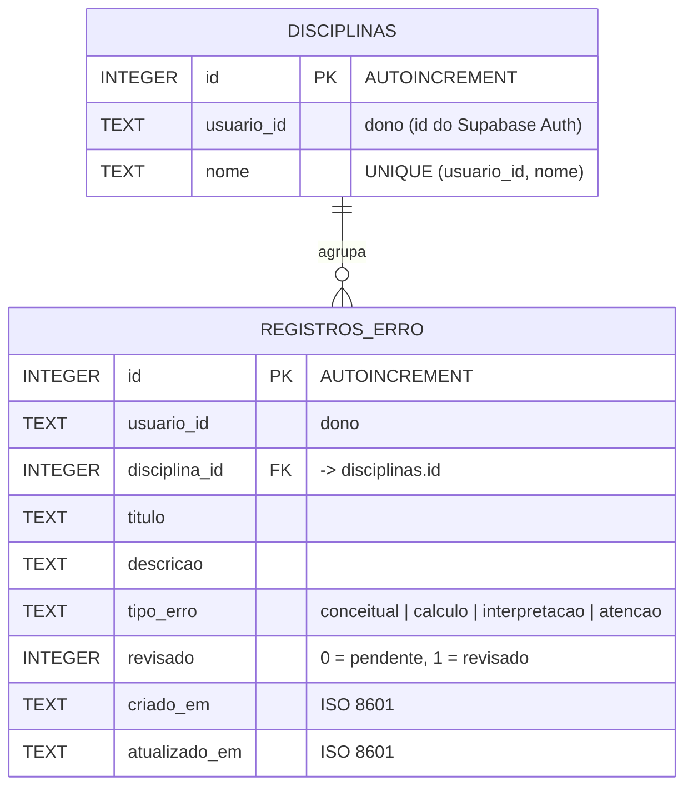

# Banco de dados local — Caderno de erros e cache offline

Persistência no próprio aparelho, seguindo as aulas LDDM08 (Shared Preferences)
e LDDM09 (SQLite com `sqflite`). O Caderno de erros funciona sem internet e é
independente do Supabase: apagar o app apaga estes dados. Desde a versão 2 o
mesmo banco guarda o cache offline do Supabase e a fila de envio (seção 4).

| Mecanismo | Pacote | Para quê |
|---|---|---|
| SQLite | `sqflite` (Android/iOS/macOS), `sqflite_common_ffi` (Windows/Linux), `sqflite_common_ffi_web` (Web) | Registros de erro e disciplinas, com CRUD |
| Shared Preferences | `shared_preferences` | Preferência "Ocultar revisados" da lista |

Arquivo do banco: `mistakemap_local.db`, versão 2
(`lib/local/banco_local.dart`). Na Web ele fica no IndexedDB do navegador,
usando `web/sqlite3.wasm` e `web/sqflite_sw.js`.

## 1. Projeto do banco de dados

### Minimundo

O estudante anota os erros que cometeu para revisar depois. Cada erro pertence
a uma disciplina, tem um tipo (conceitual, cálculo, interpretação ou atenção) e
uma situação (pendente ou revisado). Uma disciplina agrupa vários erros.
Duas contas no mesmo aparelho não veem os dados uma da outra (`usuario_id`).

### Modelo entidade-relacionamento



Cardinalidade: uma disciplina tem zero ou mais registros (1:N); cada registro
tem exatamente uma disciplina.

### Modelo físico (SQL executado no `onCreate`)

O SQLite só tem os tipos `TEXT`, `INTEGER` e `REAL`, então booleano vira
`INTEGER` (0/1) e data vira `TEXT` em ISO 8601, que ordena corretamente.

```sql
CREATE TABLE disciplinas (
  id INTEGER PRIMARY KEY AUTOINCREMENT,
  usuario_id TEXT NOT NULL,
  nome TEXT NOT NULL,
  UNIQUE (usuario_id, nome)
);

CREATE TABLE registros_erro (
  id INTEGER PRIMARY KEY AUTOINCREMENT,
  usuario_id TEXT NOT NULL,
  disciplina_id INTEGER NOT NULL
    REFERENCES disciplinas (id) ON DELETE CASCADE,
  titulo TEXT NOT NULL,
  descricao TEXT NOT NULL,
  tipo_erro TEXT NOT NULL CHECK (tipo_erro IN
    ('conceitual', 'calculo', 'interpretacao', 'atencao')),
  revisado INTEGER NOT NULL DEFAULT 0 CHECK (revisado IN (0, 1)),
  criado_em TEXT NOT NULL,
  atualizado_em TEXT NOT NULL
);

CREATE INDEX idx_registros_usuario ON registros_erro (usuario_id, atualizado_em);
CREATE INDEX idx_registros_disciplina ON registros_erro (disciplina_id);
```

A chave estrangeira só vale com `PRAGMA foreign_keys = ON`, executado no
`onConfigure` de cada conexão.

## 2. Integração com o app (CRUD)

Camadas em `lib/local/`:

| Arquivo | Papel |
|---|---|
| `registro_erro.dart` | Modelos `RegistroErro`, `Disciplina` e `TipoErro`, com `toMap`/`fromMap` |
| `banco_local.dart` | Abre o banco (`openDatabase`, `version`, `onCreate`) |
| `fabrica_banco*.dart` | Escolhe o SQLite certo para cada plataforma e o caminho do arquivo |
| `registro_erro_dao.dart` | DAO com as operações CRUD |
| `preferencias_caderno.dart` | Leitura e gravação no Shared Preferences |

Telas em `lib/caderno_erros.dart`: `TelaCadernoErros` (lista) e
`TelaRegistroErro` (criar e editar).

| Operação | Método do DAO | SQL / API do sqflite | Onde na tela |
|---|---|---|---|
| Create | `inserir` | `insert('registros_erro', mapa)` | Botão **+** ou **Novo registro** → **Salvar registro** |
| Read (todos) | `listar` | `rawQuery('SELECT r.*, d.nome ... JOIN disciplinas ...')` | Lista ao abrir a tela |
| Read (um) | `buscarPorId` | `rawQuery(... WHERE r.id = ?, [id])` | Usado pelos testes e pela edição |
| Update | `atualizar`, `marcarRevisado` | `update(..., where: 'id = ?', whereArgs: [id])` | Tocar no card → **Salvar alterações**; menu **⋯** → **Marcar como revisado** |
| Delete | `excluir` | `delete(..., where: 'id = ?', whereArgs: [id])` | Menu **⋯** → **Excluir** |

Inserir e editar rodam numa transação: a disciplina é reaproveitada pelo nome ou
criada, e disciplinas que ficam sem registros são apagadas.

Shared Preferences: o botão de funil grava `caderno_ocultar_revisados`
(`setBool`) e a tela lê o valor (`getBool`) ao abrir.

## 3. Roteiro de demonstração em aula

1. Entrar no app e, no **Início**, tocar em **Caderno de erros**.
2. **Create:** tocar em **+**, preencher disciplina, título, descrição, escolher
   o tipo e salvar. Repetir com outra disciplina.
3. **Read:** a lista mostra os registros do mais recente ao mais antigo.
4. **Update:** tocar num card, mudar o título e salvar; depois, no menu **⋯**,
   marcar como revisado.
5. **Shared Preferences:** tocar no funil para ocultar os revisados, fechar o
   app por completo e abrir de novo: o filtro continua ligado.
6. **Delete:** no menu **⋯**, excluir um registro e confirmar.
7. **Persistência:** fechar e reabrir o app; os registros continuam lá, mesmo
   sem internet.

## 4. Sincronização com o Supabase e a R2 (versão 2)

O app consulta o **Supabase primeiro** e usa o SQLite como reserva. Código em
`lib/sync/`:

| Arquivo | Papel |
|---|---|
| `sincronizador.dart` | Orquestra cache, fila, estado da conexão e Realtime |
| `armazem_sync.dart` | DAO de `cache_consultas` e `fila_sync` |
| `remoto_supabase.dart` | Envio real: Supabase (RLS do aluno) e foto para a R2 via `upload-url` |
| `sobreposicao.dart` | Mostra nas telas o que ainda está só na fila |
| `conexao.dart` | Distingue falta de rede de erro do servidor; gera UUID v4 |

```sql
CREATE TABLE cache_consultas (
  usuario_id TEXT NOT NULL,
  chave TEXT NOT NULL,        -- inicio_tentativas, lista_exercicios, ...
  dados TEXT NOT NULL,        -- JSON da última resposta do Supabase
  atualizado_em TEXT NOT NULL,
  PRIMARY KEY (usuario_id, chave)
);

CREATE TABLE fila_sync (
  id INTEGER PRIMARY KEY AUTOINCREMENT,
  usuario_id TEXT NOT NULL,
  operacao TEXT NOT NULL,     -- criar_tentativa | enviar_foto | editar_exercicio | excluir_exercicio
  dados TEXT NOT NULL,        -- JSON com os ids gerados no aparelho
  imagem BLOB,                -- foto até a R2 confirmar (máx. 8 MB)
  situacao TEXT NOT NULL DEFAULT 'pendente',  -- pendente | erro
  tentativas INTEGER NOT NULL DEFAULT 0,
  ultimo_erro TEXT,
  criado_em TEXT NOT NULL
);
```

Fluxo:

1. **Leitura.** Início, Exercícios, Mapa e Insights chamam o Supabase (limite
   de 12 s). Com resposta, ela é gravada em `cache_consultas`. Sem rede, a tela
   mostra a última resposta gravada e a pílula **Offline** aparece na barra.
2. **Escrita sem rede.** Nova submissão (com ou sem foto), edição e exclusão
   de exercício vão para `fila_sync`. Os ids são UUIDs gerados no aparelho, então
   reenviar depois de uma queda não duplica nada (`upsert` com
   `ignoreDuplicates`). A tela já mostra o item com o status
   **Aguardando conexão**.
3. **Reconexão.** Uma sonda (5 s, dobrando até 1 min), a volta do app ao
   primeiro plano ou qualquer consulta que funcione dispara o envio da fila em
   ordem: foto para a R2, exercício, tentativa e anexo; depois a análise de IA
   é pedida (o pg_cron cobre se falhar). As telas recarregam em seguida.
4. **Tempo real.** O app assina o Supabase Realtime (`subjects`, `attempts`,
   `attempt_analyses`, só INSERT/UPDATE do próprio aluno). A migration
   `20261027013000_enable_realtime_sync.sql` coloca essas tabelas na publicação.
5. **Conflitos.** O servidor manda no status e na análise. Edição offline de um
   exercício que já foi analisado é descartada com aviso
   (`guard_analyzed_exercise`). Outra recusa fica com situação `erro`, aparece
   como **Não enviado** e não é repetida até o aluno excluir o item.

Só precisa de internet: análise por IA, geração de prática e o painel Admin.
O app não exibe fotos da R2, então do lado da R2 só existe o envio.

Dentro do `flutter test` o sincronizador nasce desabilitado (vai direto ao
servidor falso e não grava no disco); `test/sincronizacao_test.dart` liga ele
com um SQLite em memória.

## Testes

- `test/banco_local_test.dart`: esquema, CRUD completo no SQLite em memória,
  isolamento por usuário, `CHECK` do tipo de erro e Shared Preferences.
- `test/caderno_erros_test.dart`: fluxo das telas (criar, editar, revisar,
  excluir) e o filtro salvo.
- `test/sincronizacao_test.dart`: cache com e sem rede, fila em ordem,
  reconexão, conflitos, sobreposição nas telas, upgrade v1 → v2 e as
  requisições idempotentes ao Supabase.

## Evolução do esquema

Mudanças sobem `BancoLocal.versao` e entram em `onUpgrade`; o `onCreate` da
versão 1 não é reescrito, pelo mesmo motivo que as migrations do Supabase são
imutáveis.
